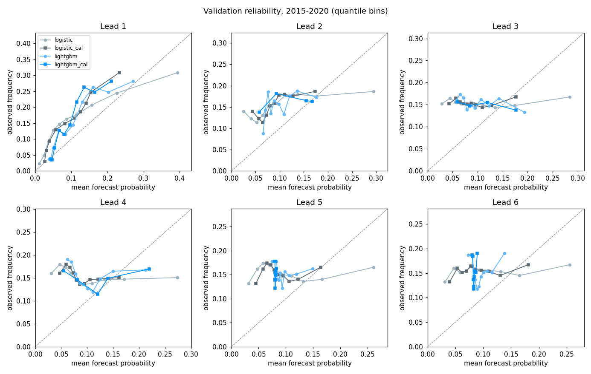

# LightGBM, calibration and model selection: validation scores (2015-2020)

heatwave_week = heatwave_days >= 3; labels from ERA5-Land (reanalysis), 4,841 wards in 19 northern states and the FCT; validation 2015-2020

Test years 2021-2026 are locked and unscored, as read from the evaluation log (hash chain verified): evaluation log test runs: 0; test-split scores recorded for this run: 0.

Run `20261013T124205Z_b82dc7bd`, generated 2026-10-13T14:13:19Z. Data `covariates-v1.0` (parquet sha256 `82583fbf5dee…`), config sha256 `b82dc7bdc424…`, seed 20261002, bootstrap B = 1000 (week blocks of 4 weeks, and whole years). LightGBM 4.7.0, 8 threads, deterministic mode.

## How the models were built

- **Tuning (MODEL-02).** Expanding-window CV on the training-era folds 2010, 2011, 2012, 2013, 2014 (each fold refits the climatology and features on its own past). Within each fold, early stopping uses the last 52 target weeks of the fold's training rows, separated from the fitting rows by the 14-week embargo. 6 strongly regularised configurations were compared per lead by mean fold Brier; the final tree count is the median early-stopping iteration.
- **Calibration (MODEL-03).** Platt or isotonic per lead, chosen by leave-one-fold-out Brier on the out-of-fold predictions of the tuning folds; outputs clipped to [0.001, 0.999]. Calibration rows are the folds' held-out years, never used for fitting or early stopping. Logistic gets the same treatment for a like-for-like comparison.
- **Selection.** Per lead, the candidate with the lowest CV Brier is selected, before looking at validation. The tuning folds also chose the LightGBM configuration, so the LightGBM CV Brier is slightly optimistic.
- **Final fits** use the full training split (seeded subsample of at most 1,500,000 rows per lead) with the tuned settings. Validation 2015-2020 is used only for the scores below.

**Reading the calls.** "Better" means the paired BSS interval excludes zero under both the 4-week block and the whole-year bootstrap. The go/no-go judgement uses leads 1, 2.

## 1. Tuning, calibration and selection (CV, training era)

| Lead | LightGBM config | Trees | Calibrator (LightGBM) | Calibrator (logistic) | CV Brier: logistic / logistic_cal / lightgbm / lightgbm_cal | Selected (by CV) |
|---|---|---|---|---|---|---|
| 1 | `nl7_mcs200` | 30 | platt | isotonic | 0.0734 / 0.0718 / 0.0713 / 0.0719 | **lightgbm** |
| 2 | `nl15_mcs200` | 12 | isotonic | platt | 0.0749 / 0.0740 / 0.0736 / 0.0747 | **lightgbm** |
| 3 | `nl15_mcs2000_l10` | 20 | isotonic | platt | 0.0736 / 0.0742 / 0.0724 / 0.0745 | **lightgbm** |
| 4 | `nl7_mcs200` | 27 | isotonic | platt | 0.0742 / 0.0743 / 0.0730 / 0.0733 | **lightgbm** |
| 5 | `nl15_mcs500_col05` | 10 | platt | platt | 0.0734 / 0.0746 / 0.0742 / 0.0754 | **logistic** |
| 6 | `nl15_mcs500_col05` | 10 | platt | platt | 0.0723 / 0.0741 / 0.0732 / 0.0751 | **logistic** |

## 2. Selected model against the best baseline (validation)

| Lead | Selected | Brier selected | Best baseline (Brier) | BSS selected vs best [week CI] [year CI] | Call | BSS selected vs recent_climatology [week CI] |
|---|---|---|---|---|---|---|
| 1 | lightgbm | 0.1251 | damped_persistence (0.1249) | -0.002 [-0.040, 0.028] [-0.028, 0.030] | not distinguishable | 0.083 [0.050, 0.110] |
| 2 | lightgbm | 0.1329 | damped_persistence (0.1322) | -0.005 [-0.030, 0.015] [-0.029, 0.016] | not distinguishable | 0.026 [0.005, 0.042] |
| 3 | lightgbm | 0.1351 | trend_season (0.1331) | -0.015 [-0.035, 0.005] [-0.023, -0.005] | not distinguishable | 0.010 [-0.016, 0.029] |
| 4 | lightgbm | 0.1345 | trend_season (0.1331) | -0.010 [-0.028, 0.009] [-0.019, 0.001] | not distinguishable | 0.015 [-0.008, 0.033] |
| 5 | logistic | 0.1372 | trend_season (0.1331) | -0.031 [-0.055, -0.006] [-0.044, -0.017] | worse | -0.005 [-0.035, 0.021] |
| 6 | logistic | 0.1367 | trend_season (0.1332) | -0.027 [-0.049, -0.003] [-0.044, -0.014] | worse | -0.001 [-0.029, 0.024] |

All candidates (validation Brier, and BSS against the best baseline):

| Lead | logistic Brier (BSS vs best) | logistic_cal Brier (BSS vs best) | lightgbm Brier (BSS vs best) | lightgbm_cal Brier (BSS vs best) |
|---|---|---|---|---|
| 1 | 0.1271 (-0.017) | 0.1270 (-0.017) | 0.1251 (-0.002) | 0.1270 (-0.017) |
| 2 | 0.1360 (-0.029) | 0.1341 (-0.014) | 0.1329 (-0.005) | 0.1335 (-0.009) |
| 3 | 0.1383 (-0.039) | 0.1357 (-0.019) | 0.1351 (-0.015) | 0.1366 (-0.026) |
| 4 | 0.1387 (-0.042) | 0.1359 (-0.021) | 0.1345 (-0.010) | 0.1361 (-0.022) |
| 5 | 0.1372 (-0.031) | 0.1355 (-0.018) | 0.1337 (-0.004) | 0.1355 (-0.018) |
| 6 | 0.1367 (-0.027) | 0.1356 (-0.018) | 0.1336 (-0.003) | 0.1351 (-0.014) |

## 3. LightGBM against logistic regression (validation)

| Lead | LightGBM vs logistic (raw) [week CI] [year CI] | Call | LightGBM cal vs logistic [week CI] [year CI] | Call |
|---|---|---|---|---|
| 1 | 0.015 [-0.013, 0.042] [-0.013, 0.045] | not distinguishable | 0.000 [-0.035, 0.036] [-0.037, 0.037] | not distinguishable |
| 2 | 0.023 [0.001, 0.044] [0.004, 0.037] | better | 0.019 [-0.003, 0.040] [0.004, 0.033] | not distinguishable |
| 3 | 0.023 [0.006, 0.042] [0.013, 0.033] | better | 0.012 [-0.007, 0.034] [0.001, 0.023] | not distinguishable |
| 4 | 0.031 [0.019, 0.043] [0.023, 0.038] | better | 0.019 [0.007, 0.032] [0.014, 0.025] | better |
| 5 | 0.026 [0.007, 0.047] [0.014, 0.040] | better | 0.012 [-0.013, 0.042] [-0.005, 0.033] | not distinguishable |
| 6 | 0.023 [0.003, 0.045] [0.003, 0.047] | better | 0.012 [-0.011, 0.037] [-0.007, 0.039] | not distinguishable |

## 4. Reliability on held-out validation rows

Tolerance, fixed before the run: |mean p - observed rate| <= 0.02, and every quantile bin holding at least 1% of rows within 0.05 of the diagonal.

| Lead | Predictor | Mean p - observed | Max bin deviation | Within tolerance |
|---|---|---|---|---|
| 1 | logistic | -0.037 | 0.085 | NO |
| 1 | logistic_cal | -0.056 | 0.093 | NO |
| 1 | lightgbm | -0.039 | 0.102 | NO |
| 1 | lightgbm_cal | -0.053 | 0.127 | NO |
| 2 | logistic | -0.046 | 0.114 | NO |
| 2 | logistic_cal | -0.062 | 0.096 | NO |
| 2 | lightgbm | -0.052 | 0.110 | NO |
| 2 | lightgbm_cal | -0.047 | 0.088 | NO |
| 3 | logistic | -0.047 | 0.124 | NO |
| 3 | logistic_cal | -0.063 | 0.109 | NO |
| 3 | lightgbm | -0.052 | 0.109 | NO |
| 3 | lightgbm_cal | -0.065 | 0.097 | NO |
| 4 | logistic | -0.047 | 0.132 | NO |
| 4 | logistic_cal | -0.064 | 0.120 | NO |
| 4 | lightgbm | -0.045 | 0.129 | NO |
| 4 | lightgbm_cal | -0.050 | 0.111 | NO |
| 5 | logistic | -0.049 | 0.116 | NO |
| 5 | logistic_cal | -0.064 | 0.109 | NO |
| 5 | lightgbm | -0.055 | 0.103 | NO |
| 5 | lightgbm_cal | -0.073 | 0.098 | NO |
| 6 | logistic | -0.050 | 0.112 | NO |
| 6 | logistic_cal | -0.063 | 0.106 | NO |
| 6 | lightgbm | -0.056 | 0.114 | NO |
| 6 | lightgbm_cal | -0.070 | 0.107 | NO |

## 5. Extrapolation risk (MODEL-04)

Share of validation feature values (all wards, validation origins) outside the training range (training origins). 22 of 55 panel and static features have some values outside; the largest shares:

| Feature | Family | Training range | Validation range | Below | Above | Share outside |
|---|---|---|---|---|---|---|
| `mhi_anom_mean156` | trend | -0.69 to 0.55 | -0.16 to 0.81 | 0 | 116,667 | 7.68% |
| `rh_anom_roll4` | land_humidity | -3.02 to 2.58 | -4.81 to 3.60 | 2,425 | 1,157 | 0.24% |
| `sm_anom_roll4` | land_humidity | -4.26 to 4.51 | -10.08 to 21.44 | 1,458 | 2,032 | 0.23% |
| `pr_anom_sum4` | land_humidity | -7.74 to 14.08 | -10.71 to 51.93 | 39 | 2,246 | 0.15% |
| `pr_anom_sum8` | land_humidity | -11.09 to 20.59 | -12.89 to 52.64 | 29 | 2,093 | 0.14% |
| `rh_anom_lag0` | land_humidity | -4.65 to 5.87 | -9.29 to 8.19 | 1,146 | 739 | 0.12% |
| `sm_anom_lag0` | land_humidity | -6.59 to 10.80 | -23.30 to 74.39 | 1,017 | 834 | 0.12% |
| `xhi_anom_roll2` | recent_heat | -3.36 to 3.38 | -3.66 to 4.15 | 79 | 16 | 0.01% |
| `mhi_anom_roll8` | recent_heat | -2.03 to 2.20 | -1.44 to 2.38 | 0 | 94 | 0.01% |
| `xhi_anom_roll4` | recent_heat | -2.76 to 2.76 | -2.73 to 3.11 | 0 | 68 | 0.00% |
| `mhi_anom_roll4` | recent_heat | -2.57 to 2.66 | -2.45 to 2.85 | 0 | 55 | 0.00% |
| `mhi_anom_roll2` | recent_heat | -3.60 to 3.06 | -2.88 to 3.67 | 0 | 24 | 0.00% |
| `lga_mean_mhi_anom_lag0` | spatial | -4.13 to 3.62 | -3.72 to 3.95 | 0 | 21 | 0.00% |
| `mhi_anom_lag0` | recent_heat | -4.71 to 3.72 | -3.84 to 4.72 | 0 | 16 | 0.00% |
| `mhi_anom_lag1` | recent_heat | -4.71 to 3.72 | -3.84 to 4.72 | 0 | 16 | 0.00% |

Trees predict as at the edge of the training range beyond it, so these rows carry extrapolation risk under warming.

## 6. LightGBM gain importance

Share of total split gain per feature in the final models. This describes the fitted model, not causes.

| Rank | Lead 1 feature | gain share | Lead 2 feature | gain share |
|---|---|---|---|---|
| 1 | `state_mean_hd_lag0` | 17.4% | `hd_roll8` | 27.3% |
| 2 | `state_mean_mhi_anom_lag0` | 15.3% | `target_season_cos` | 15.9% |
| 3 | `lga_mean_mhi_anom_lag0` | 15.1% | `mhi_anom_roll8` | 8.4% |
| 4 | `target_season_cos` | 11.5% | `target_season_sin` | 7.1% |
| 5 | `mhi_anom_lag0` | 10.8% | `state_mean_hd_lag0` | 5.8% |
| 6 | `hd_roll8` | 5.5% | `hw_frac52` | 3.7% |
| 7 | `target_season_sin` | 5.1% | `state_mean_mhi_anom_lag0` | 3.6% |
| 8 | `xhi_anom_lag0` | 2.4% | `hw_roll8` | 3.0% |
| 9 | `hw_frac52` | 2.2% | `rh_anom_roll4` | 2.7% |
| 10 | `rh_anom_roll4` | 2.2% | `xhi_anom_roll2` | 1.9% |

## Notes

- Labels are ERA5-Land reanalysis heatwave weeks (3+ heatwave days), not station-confirmed.
- The heatwave detection layer is rule-based and separate from this trained forecast layer.
- Hyperparameters, tree counts and calibrators are recorded in `docs/forecast/MODEL_SELECTION.json` and must be frozen in the pre-registration before the single test evaluation (Phase 14).

<!-- generated by scripts/forecast_lightgbm.py -->
