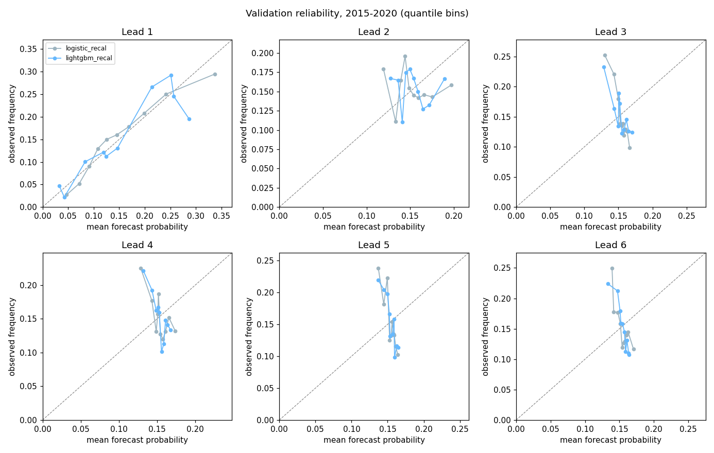

# Recalibration on the validation years, leave-one-year-out (2015-2020)

heatwave_week = heatwave_days >= 3; labels from ERA5-Land (reanalysis), 4,841 wards in 19 northern states and the FCT; validation 2015-2020

Test years 2021-2026 are locked and unscored, as read from the evaluation log (hash chain verified): evaluation log test runs: 0; test-split scores recorded for this run: 0.

Run `20261013T143836Z_b82dc7bd`, generated 2026-10-13T15:02:40Z, from the stored Phase 12 predictions of run `20261013T124205Z_b82dc7bd` (no model refitted). Data `covariates-v1.0` (parquet sha256 `82583fbf5dee…`), config sha256 `b82dc7bdc424…`, seed 20261002, bootstrap B = 1000.

**Why.** The Phase 12 calibrators were fitted on 2010-2014, when heatwave weeks were much rarer than in 2015-2020, so every model under-predicted. Here each validation year is recalibrated with a calibrator fitted on the other five validation years only (Platt or isotonic, chosen by the leave-one-year-out Brier). The best baselines are recalibrated the same way, so the comparison stays fair.

**Caveat.** The 2015-2020 labels are now used for calibration, so the scores below are leave-one-year-out estimates, not a pure hold-out. The locked 2021-2026 test is the clean check.

## 1. Calibrator chosen per lead (leave-one-year-out Brier)

| Lead | Predictor | Method | LOYO Brier raw / Platt / isotonic |
|---|---|---|---|
| 1 | logistic | platt | 0.1271 / 0.1242 / 0.1245 |
| 1 | lightgbm | isotonic | 0.1251 / 0.1239 / 0.1235 |
| 1 | damped_persistence | platt | 0.1249 / 0.1232 / 0.1236 |
| 1 | trend_season | platt | 0.1330 / 0.1308 / 0.1312 |
| 2 | logistic | platt | 0.1360 / 0.1308 / 0.1311 |
| 2 | lightgbm | platt | 0.1329 / 0.1306 / 0.1308 |
| 2 | damped_persistence | platt | 0.1322 / 0.1301 / 0.1304 |
| 2 | trend_season | platt | 0.1331 / 0.1308 / 0.1312 |
| 3 | logistic | platt | 0.1383 / 0.1312 / 0.1312 |
| 3 | lightgbm | platt | 0.1351 / 0.1309 / 0.1309 |
| 3 | damped_persistence | platt | 0.1345 / 0.1316 / 0.1317 |
| 3 | trend_season | platt | 0.1331 / 0.1308 / 0.1312 |
| 4 | logistic | platt | 0.1387 / 0.1309 / 0.1312 |
| 4 | lightgbm | platt | 0.1345 / 0.1308 / 0.1309 |
| 4 | damped_persistence | isotonic | 0.1369 / 0.1313 / 0.1310 |
| 4 | trend_season | platt | 0.1331 / 0.1308 / 0.1312 |
| 5 | logistic | platt | 0.1372 / 0.1308 / 0.1313 |
| 5 | lightgbm | platt | 0.1337 / 0.1308 / 0.1311 |
| 5 | damped_persistence | platt | 0.1365 / 0.1309 / 0.1309 |
| 5 | trend_season | platt | 0.1331 / 0.1308 / 0.1312 |
| 6 | logistic | platt | 0.1367 / 0.1309 / 0.1313 |
| 6 | lightgbm | platt | 0.1336 / 0.1310 / 0.1312 |
| 6 | damped_persistence | platt | 0.1356 / 0.1309 / 0.1315 |
| 6 | trend_season | platt | 0.1332 / 0.1308 / 0.1312 |

## 2. Recalibrated models against the baselines

Phase 12 selected model per lead, recalibrated, against the best baseline as scored in Phase 12 and against the same baseline recalibrated.

| Lead | Model | Brier | Best baseline | BSS vs best [week CI] [year CI] | Call | BSS vs best baseline recalibrated [week CI] [year CI] | Call | BSS vs recent_climatology |
|---|---|---|---|---|---|---|---|---|
| 1 | lightgbm_recal | 0.1235 | damped_persistence (0.1249) | 0.011 [-0.025, 0.039] [-0.013, 0.037] | not distinguishable | -0.003 [-0.028, 0.019] [-0.022, 0.020] | not distinguishable | 0.095 |
| 2 | lightgbm_recal | 0.1306 | damped_persistence (0.1322) | 0.013 [-0.015, 0.035] [-0.008, 0.031] | not distinguishable | -0.004 [-0.015, 0.006] [-0.013, 0.005] | not distinguishable | 0.044 |
| 3 | lightgbm_recal | 0.1309 | trend_season (0.1331) | 0.016 [-0.001, 0.033] [0.002, 0.028] | not distinguishable | -0.001 [-0.008, 0.006] [-0.003, 0.001] | not distinguishable | 0.041 |
| 4 | lightgbm_recal | 0.1308 | trend_season (0.1331) | 0.017 [-0.002, 0.034] [0.004, 0.028] | not distinguishable | -0.000 [-0.007, 0.005] [-0.003, 0.003] | not distinguishable | 0.042 |
| 5 | logistic_recal | 0.1308 | trend_season (0.1331) | 0.017 [-0.002, 0.033] [0.001, 0.028] | not distinguishable | -0.000 [-0.007, 0.006] [-0.004, 0.003] | not distinguishable | 0.042 |
| 6 | logistic_recal | 0.1309 | trend_season (0.1332) | 0.017 [-0.000, 0.033] [-0.001, 0.028] | not distinguishable | -0.000 [-0.008, 0.006] [-0.004, 0.003] | not distinguishable | 0.041 |

All recalibrated predictors (Brier):

| Lead | logistic_recal | lightgbm_recal | damped_persistence_recal | trend_season_recal | logistic | lightgbm (raw) |
|---|---|---|---|---|---|---|
| 1 | 0.1242 | 0.1235 | 0.1232 | 0.1308 | 0.1271 | 0.1251 |
| 2 | 0.1308 | 0.1306 | 0.1301 | 0.1308 | 0.1360 | 0.1329 |
| 3 | 0.1312 | 0.1309 | 0.1316 | 0.1308 | 0.1383 | 0.1351 |
| 4 | 0.1309 | 0.1308 | 0.1310 | 0.1308 | 0.1387 | 0.1345 |
| 5 | 0.1308 | 0.1308 | 0.1309 | 0.1308 | 0.1372 | 0.1337 |
| 6 | 0.1309 | 0.1310 | 0.1309 | 0.1308 | 0.1367 | 0.1336 |

## 3. Reliability after recalibration

Same tolerance as Phase 12: |mean p - observed rate| <= 0.02, and every quantile bin holding at least 1% of rows within 0.05 of the diagonal.

| Lead | Predictor | Mean p - observed | Max bin deviation | Within tolerance |
|---|---|---|---|---|
| 1 | logistic_recal | -0.000 | 0.042 | yes |
| 1 | lightgbm_recal | -0.001 | 0.091 | NO |
| 1 | damped_persistence_recal | -0.000 | 0.064 | NO |
| 1 | trend_season_recal | -0.000 | 0.084 | NO |
| 2 | logistic_recal | -0.000 | 0.060 | NO |
| 2 | lightgbm_recal | -0.000 | 0.040 | yes |
| 2 | damped_persistence_recal | -0.001 | 0.045 | yes |
| 2 | trend_season_recal | -0.000 | 0.083 | NO |
| 3 | logistic_recal | -0.000 | 0.123 | NO |
| 3 | lightgbm_recal | -0.000 | 0.105 | NO |
| 3 | damped_persistence_recal | -0.000 | 0.107 | NO |
| 3 | trend_season_recal | -0.000 | 0.083 | NO |
| 4 | logistic_recal | -0.000 | 0.097 | NO |
| 4 | lightgbm_recal | -0.000 | 0.089 | NO |
| 4 | damped_persistence_recal | -0.000 | 0.090 | NO |
| 4 | trend_season_recal | -0.000 | 0.084 | NO |
| 5 | logistic_recal | -0.000 | 0.101 | NO |
| 5 | lightgbm_recal | 0.000 | 0.083 | NO |
| 5 | damped_persistence_recal | -0.000 | 0.096 | NO |
| 5 | trend_season_recal | -0.000 | 0.090 | NO |
| 6 | logistic_recal | 0.000 | 0.111 | NO |
| 6 | lightgbm_recal | 0.000 | 0.091 | NO |
| 6 | damped_persistence_recal | -0.000 | 0.079 | NO |
| 6 | trend_season_recal | -0.000 | 0.086 | NO |

## Notes

- The calibrators fitted on all six validation years are recorded in `docs/forecast/RECALIBRATION.json`; Phase 14 freezes this recipe (refit on 1991-2020, calibrate on 2015-2020) before the single test.
- Labels are ERA5-Land reanalysis heatwave weeks (3+ heatwave days), not station-confirmed.
- The heatwave detection layer is rule-based and separate from this trained forecast layer.

<!-- generated by scripts/forecast_recalibrate.py -->
